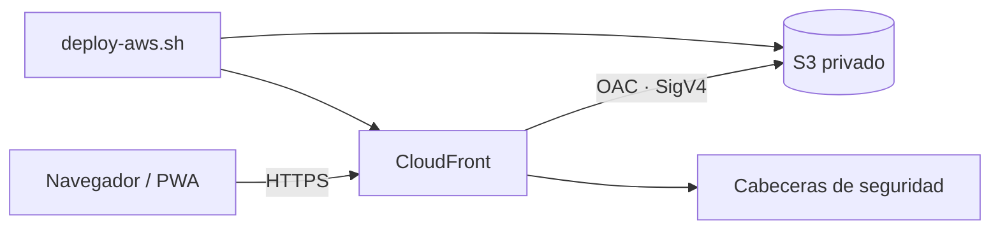

# Despliegue seguro en AWS

Esta guía publica la PWA con **Amazon S3 privado + Amazon CloudFront + Origin Access Control (OAC)**. No usa el endpoint público de sitio web de S3.

> **Costos:** S3, CloudFront, transferencia, solicitudes e invalidaciones pueden generar cargos. La plantilla usa `PriceClass_100` para limitar el conjunto de ubicaciones de borde, pero no garantiza costo cero. Revisa AWS Pricing y configura un presupuesto antes de tratar el entorno como permanente.

## Despliegue vigente

La instancia actual está disponible en [https://d1or4j0yth4d72.cloudfront.net](https://d1or4j0yth4d72.cloudfront.net). Región, stack, controles observados y pruebas posteriores al despliegue se registran en [`DEPLOYMENT-STATUS.md`](DEPLOYMENT-STATUS.md).

## Arquitectura



CloudFront sirve la URL pública y redirige HTTP a HTTPS. S3 mantiene activos los cuatro controles de Block Public Access y su política solo concede `s3:GetObject` al servicio CloudFront cuando la solicitud proviene del ARN de la distribución creada.

## Recursos creados

La plantilla `infra/cloudformation.yaml` crea:

| Recurso | Propósito | Protección/costo relevante |
|---|---|---|
| Bucket S3 | Archivos estáticos | Privado, SSE-S3, versionado, `DeletionPolicy: Retain` |
| Bucket policy | Lectura del origen | Solo CloudFront OAC y denegación de transporte no seguro |
| CloudFront OAC | Firma SigV4 hacia S3 | Sustituye OAI para un despliegue nuevo |
| CloudFront distribution | CDN y HTTPS | `PriceClass_100`, HTTP/2 y HTTP/3; el certificado predeterminado es administrado por AWS |
| Response headers policy | CSP, HSTS y otras cabeceras | Bloquea recursos no pertenecientes al mismo origen |

No crea usuarios, claves de acceso, roles IAM, certificados, zonas DNS, WAF ni buckets de logs.

## Requisitos previos

- AWS CLI v2.
- Una cuenta y región elegidas explícitamente.
- Credenciales temporales o un perfil de mínimo privilegio capaz de gestionar los recursos anteriores y subir objetos.
- Permiso para generar una invalidación CloudFront.

No uses credenciales administrativas para automatización habitual. Para una primera ejecución, confirma la identidad antes de cualquier cambio:

```bash
aws sts get-caller-identity --profile <perfil>
aws configure get region --profile <perfil>
```

El modo de escritura exige `--confirm-account` y el SHA-256 exacto de la plantilla mostrado por la revisión. Al actualizar, también exige el `StackId` inmutable del stack existente. Esto impide reutilizar accidentalmente el nombre de otro stack o desplegar una plantilla modificada después de la aprobación.

## 1. Revisar sin modificar AWS

Desde la raíz del repositorio:

```bash
./scripts/deploy-aws.sh \
  --profile <perfil> \
  --region us-east-1 \
  --stack calculadora-varillas-web \
  --environment prod
```

Sin `--apply`, el script solo valida herramientas, identidad, propiedad de un stack existente y archivos locales. Muestra cuenta, región, `DeploymentId`, `StackId` (si existe) y SHA-256 de la plantilla. No crea change sets ni modifica recursos.

También puedes validar la sintaxis de la plantilla directamente:

```bash
aws cloudformation validate-template \
  --template-body file://infra/cloudformation.yaml \
  --profile <perfil> \
  --region us-east-1
```

## 2. Desplegar

Después de revisar cuenta, región, permisos, costos y SHA:

```bash
./scripts/deploy-aws.sh \
  --profile <perfil> \
  --region us-east-1 \
  --stack calculadora-varillas-web \
  --environment prod \
  --confirm-account <AWS_ACCOUNT_ID> \
  --confirm-template-sha <SHA256_MOSTRADO> \
  --apply
```

Para actualizar un stack existente, agrega el valor completo que mostró la revisión:

```bash
--confirm-stack-id <STACK_ARN_COMPLETO>
```

El script:

1. vuelve a verificar identidad, cuenta, región y SHA;
2. si el stack existe, comprueba marcador, repositorio, proyecto, entorno y `DeploymentId` antes de aceptarlo;
3. crea un change set sin ejecutarlo y muestra cada cambio;
4. rechaza automáticamente cualquier eliminación o reemplazo de infraestructura;
5. ejecuta únicamente el change set revisado;
6. aplica una stack policy que impide reemplazar o eliminar el bucket y la distribución durante actualizaciones;
7. activa protección de terminación cuando el entorno es `prod`;
8. obtiene bucket y distribución desde outputs verificados;
9. rechaza enlaces simbólicos y objetos S3 ajenos a la allowlist;
10. publica archivo por archivo (recursos primero; service worker e HTML al final), sin `sync --delete`;
11. asigna caché revalidable, crea una invalidación `/*` y espera a que termine;
12. comprueba HTTPS, CSP, HSTS, tipos MIME y recursos fundamentales.

La creación inicial de CloudFront puede tardar varios minutos.

## 3. Verificar

La URL se obtiene con:

```bash
aws cloudformation describe-stacks \
  --stack-name calculadora-varillas-web \
  --query "Stacks[0].Outputs[?OutputKey=='SiteUrl'].OutputValue" \
  --output text \
  --profile <perfil> \
  --region us-east-1
```

Pruebas recomendadas:

```bash
curl -I "https://<distribution>.cloudfront.net/"
curl -I "https://<distribution>.cloudfront.net/sw.js"
curl -I "https://<distribution>.cloudfront.net/manifest.webmanifest"
```

Comprueba además:

- el bucket rechaza acceso público directo;
- la calculadora devuelve 8 barras para 30 × 50 cm, 1 % y 5/8";
- DevTools → Application muestra manifest y service worker activos;
- una segunda carga funciona en modo offline;
- no hay errores en la consola;
- el panel Network muestra CSP, HSTS y `X-Content-Type-Options`.

## Actualizar la aplicación

1. Cambia el código.
2. Si modificaste el app shell, incrementa `VERSION` en `sw.js`.
3. Valida localmente.
4. Ejecuta de nuevo el modo de revisión, confirma el SHA/StackId resultantes y repite con `--apply`.

CloudFormation no recrea recursos si la plantilla no cambió; el script actualiza objetos y realiza la invalidación. La PWA mostrará “Hay una nueva versión disponible” cuando el navegador instale el nuevo worker.

## Rollback

- **Infraestructura:** CloudFormation revierte una actualización fallida automáticamente.
- **Contenido:** el bucket tiene versionado. Para restaurar, identifica `VersionId` y copia esa versión como la actual; luego invalida CloudFront.
- **PWA:** si el error está en el worker, restaura `sw.js`, incrementa de nuevo `VERSION` y publica. No reutilices una versión de cache que ya se distribuyó.

Ejemplo de inspección sin modificar:

```bash
aws s3api list-object-versions \
  --bucket <BUCKET_OUTPUT> \
  --prefix sw.js \
  --profile <perfil>
```

## Eliminación segura

La eliminación destruye la distribución y puede interrumpir el sitio. El bucket está protegido con `DeletionPolicy: Retain`; eliminar el stack **no elimina sus objetos**. Los stacks `prod` también tienen protección de terminación. El script `destroy-aws.sh` comprueba el marcador, tags, tipos de recursos, `StackId`, entorno y cuenta; nunca desactiva esa protección ni purga datos.

Primero revisa sin modificar:

```bash
./scripts/destroy-aws.sh \
  --profile <perfil> --region us-east-1 --stack calculadora-varillas-web
```

Si la protección está activa, cualquier eliminación se detiene. Desactivarla es una acción de seguridad independiente que requiere aprobación explícita y no está automatizada en este repositorio. No ejecutes estas acciones en un entorno activo sin esa aprobación y un respaldo verificado.

Procedimiento general:

1. Confirma que la URL no tiene usuarios ni dependencias.
2. Conserva los outputs y una copia de los objetos/versiones necesarios.
3. Elimina el stack de CloudFormation de forma explícita.
4. Verifica qué bucket quedó retenido.
5. Solo si también se aprobó borrar datos, elimina todas las versiones y después el bucket.

La limpieza de versiones es irreversible y se deja deliberadamente fuera de los scripts del repositorio.

## Dominio personalizado (opcional)

Para `app.ejemplo.com` se necesita:

1. certificado ACM en `us-east-1`;
2. alias en la distribución;
3. registro DNS (por ejemplo, Route 53) hacia CloudFront;
4. actualización de `id`, `start_url` y, si cambia la ruta base, `scope` del manifest.

No agregues el dominio a la plantilla hasta tener control de DNS y un proceso de renovación/validación del certificado.

## Observabilidad y presupuesto

Este despliegue académico no activa logs de acceso por defecto. Antes de un uso operativo, decide explícitamente:

- CloudFront standard logging y destino privado;
- retención, cifrado y acceso a logs;
- alarma o presupuesto de costos;
- AWS Config/CloudTrail/GuardDuty según las políticas de la cuenta;
- responsable y periodo de revisión.

## Fuentes

- [AWS: restringir acceso a un origen S3 con CloudFront OAC](https://docs.aws.amazon.com/AmazonCloudFront/latest/DeveloperGuide/private-content-restricting-access-to-s3.html)
- [AWS: comenzar con un sitio estático seguro y CloudFormation](https://docs.aws.amazon.com/AmazonCloudFront/latest/DeveloperGuide/getting-started-secure-static-website-cloudformation-template.html)
- [AWS: requerir HTTPS entre viewers y CloudFront](https://docs.aws.amazon.com/AmazonCloudFront/latest/DeveloperGuide/using-https-viewers-to-cloudfront.html)
- [AWS CloudFormation: configuración de certificado de viewer y restricciones del certificado predeterminado](https://docs.aws.amazon.com/AWSCloudFormation/latest/TemplateReference/aws-properties-cloudfront-distribution-viewercertificate.html)
- [AWS: configuración de sitio estático en S3 y recomendación de conservar Block Public Access](https://docs.aws.amazon.com/AmazonS3/latest/userguide/HostingWebsiteOnS3Setup.html)

Content was rephrased for compliance with licensing restrictions.
